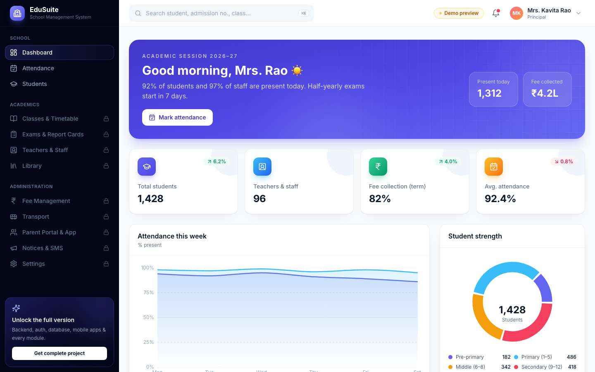
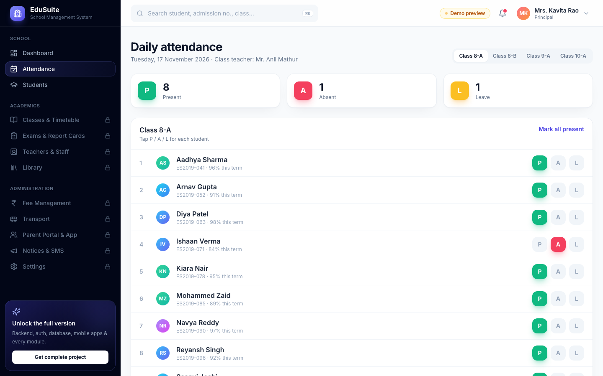
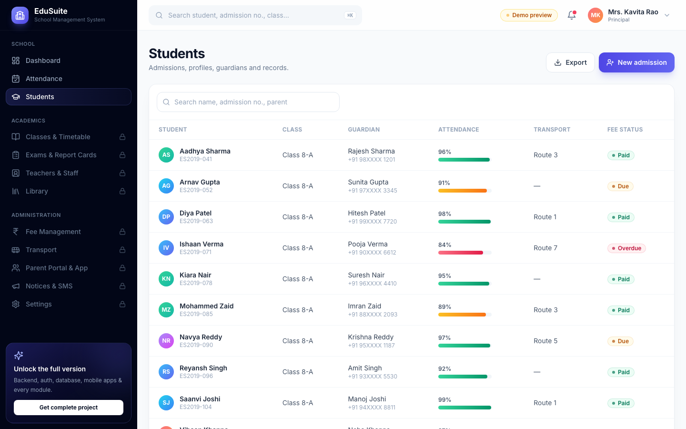

# School Management System | School ERP Software | EduSuite

**Modern School Management Software to Simplify Academic and Administrative Operations**

Looking for a reliable **School Management System** to manage students, teachers, attendance, academic records, fees, examinations, and everyday school operations?

**EduSuite by Naya Prayog Technologies** is an education management platform designed to help schools and educational institutions organize their academic and administrative activities through a centralized digital system.

The platform brings essential education management capabilities together, helping institutions reduce manual paperwork, organize student information, improve administrative workflows, and manage institutional activities more efficiently.

Whether you are establishing a new school, digitizing an existing institution, or looking for a customizable School ERP Software solution, EduSuite provides a platform to support your digital transformation.

**Interested in implementing a School Management System for your institution? Contact Naya Prayog Technologies for a product demonstration and customization discussion.**

---

## What Is a School Management System?

A School Management System is software that helps educational institutions manage their day-to-day academic and administrative operations from a centralized platform.

Instead of maintaining disconnected spreadsheets, registers, and manual records, schools can organize important information digitally.

A modern school ERP system can help institutions manage:

- Student information and records
- Student admissions and enrollment
- Attendance management
- Staff and employee management
- Fee and financial records
- Examinations and academic performance
- Marksheet and certificate management
- Parent communication and student information access
- Educational materials and learning resources
- Administrative activities and reporting

The availability of individual modules depends on the selected implementation and configuration.

## EduSuite – School and Education Management Platform

EduSuite is developed by **Naya Prayog Technologies** to support the digital management requirements of educational institutions.

<PRIVATE_URL>

The platform is designed around different users and administrative responsibilities, providing a structured way to manage institutional information and activities.

## Key Features and Modules

### 1. Student Management System

Organize student information and academic records through a centralized student management solution.

- Maintain student profiles and records
- Organize student information
- Access student-related details
- Manage student identification information
- Support student record lookup

### 2. Admission and Enrollment Management

Digitize student admission-related workflows and maintain organized enrollment information.

- Maintain admission records
- Organize student enrollment details
- Manage student information
- Maintain institutional admission data

### 3. Attendance Management System

Support attendance-related activities for students and staff.

- Manage student attendance records
- Maintain staff attendance information
- Organize attendance data
- Access attendance-related information

### 4. Fee Management

Organize student fee-related information and institutional records.

- Maintain student fee records
- Organize fee-related information
- Access student financial records
- Support fee administration workflows

### 5. Examination and Result Management

Organize examination-related academic information.

- Manage examination records
- Maintain student marks and academic results
- Organize marksheets
- Support academic record management

### 6. Marksheet and Certificate Management

Manage important academic documents through a centralized system.

- Student marksheet management
- Certificate management
- Organized academic records
- Student document lookup

### 7. Staff and HR Management

Maintain institutional staff information and support staff-related administration.

- Manage staff information
- Maintain employee records
- Organize staff-related information
- Support attendance management

### 8. Learning Materials and Educational Resources

Provide organized access to educational resources where enabled.

- Manage learning materials
- Organize educational resources
- Provide access to learning videos
- Support digital learning activities

### 9. Parent and Student Information Access

Support communication and access to relevant student information through dedicated dashboard capabilities where configured.

- Parent dashboard
- Student information access
- Academic information visibility
- Centralized student-related information

### 10. Administrative Dashboard

Provide administrators with a centralized environment to manage institutional information and platform activities.

- Administrative dashboard
- Centralized management interface
- Access to relevant institutional records
- Organized administration workflows

---

## Who Can Use This School ERP Software?

EduSuite can be evaluated by:

- Private schools
- Public and independent educational institutions
- K-12 schools
- Primary and secondary schools
- Higher secondary schools
- Educational organizations
- Schools planning digital transformation
- Institutions looking for centralized student management

The exact suitability and configuration should be evaluated against each institution's operational requirements.

## Benefits of Using School Management Software

**Centralized Information Management**

Keep important student, staff, and institutional information organized in a centralized digital environment.

**Reduced Manual Administration**

Digitize suitable administrative workflows and reduce dependence on disconnected manual records.

**Better Student Record Management**

Organize student profiles, academic information, attendance, and related documents.

**Simplified Academic Administration**

Manage examination information, marksheets, certificates, and learning resources in an organized manner.

**Improved Institutional Visibility**

Provide relevant users with access to information through configured administrative and user dashboards.

**Scalable Digital Foundation**

Build a more organized digital foundation for your institution as its requirements evolve.

## Platform and Accessibility

EduSuite is designed as a multi-platform education management solution.

- Web platform
- Android application
- iOS application

Available modules, platform functionality, integrations, and deployment options should be confirmed during the product demonstration.

## Customization and Implementation

Every educational institution has its own operational requirements.

Naya Prayog Technologies can discuss customization and implementation requirements such as:

- Institutional branding and interface customization
- School-specific workflows
- Additional management modules
- Student and staff management requirements
- Custom reports and dashboards
- Third-party integrations
- Data migration requirements
- Deployment and technical support

Customization, implementation timelines, and commercial terms depend on the agreed project scope.

## Why Choose Naya Prayog Technologies?

**Naya Prayog Technologies** develops software products and custom digital solutions for businesses and educational institutions.

Our technology capabilities include:

- Education Management Software
- School ERP Development
- Learning Management Systems
- Student Management Software
- Custom Web Application Development
- Android and iOS App Development
- API and Backend Development
- Business Process Automation

We focus on building practical software solutions that help organizations improve their operations through technology.

Website: https://nayaprayog.com/

## Frequently Asked Questions

### What is the best School Management System for a school?

The right solution depends on the institution's size, administrative workflows, academic requirements, budget, and required integrations. EduSuite can be evaluated through a product demonstration against your school's requirements.

### What is School ERP Software?

School ERP Software is a centralized platform used to organize school operations such as student management, attendance, fees, examinations, staff administration, and academic records.

### Can EduSuite manage student records?

Yes. Student information and record management are among the core capabilities of the EduSuite platform.

### Does EduSuite support attendance management?

The platform includes student and staff attendance management capabilities.

### Can the software be customized for our school?

Customization requirements can be discussed, including institutional branding, additional workflows, modules, and integrations.

### How can we request a demo?

Contact Naya Prayog Technologies using the contact information below to discuss your institution's requirements and arrange a product demonstration.

---

## Request a School Management Software Demo

**Ready to digitize your school's administration?**

Explore EduSuite and discuss how a centralized School Management System can support your institution.

**Naya Prayog Technologies**

- Website: https://nayaprayog.com/
- EduSuite: https://nayaprayog.com/edsuite/
- Email: support@nayaprayog.com
- Phone: +91 7991327022
- WhatsApp: https://wa.me/917991327022

**Contact us for a product demo, customization discussion, or School ERP development proposal.**

---

## Related Software Solutions

Explore other software solutions from Naya Prayog Technologies:

- Learning Management System (LMS)
- College Management System
- Student Management System
- Coaching Institute Management Software
- Education ERP Software
- School Fee Management Software

Visit https://nayaprayog.com/ to explore our software development services and digital solutions.

---

## Developed By

**Naya Prayog Technologies**

Software Products | Education Technology | Custom Software Development

Website: https://nayaprayog.com/

© Naya Prayog Technologies. All rights reserved.

**Note:** This repository is a product and service showcase. It does not distribute the complete proprietary EduSuite source code or grant permission to reproduce, redistribute, or commercially use the software.

<!-- screenshots -->
## Screenshots

**Dashboard**

<table>
  <tr>
    <td align="center" width="50%"><b>Attendance</b>  </td>
    <td align="center" width="50%"><b>Students</b>  </td>
  </tr>
</table>
